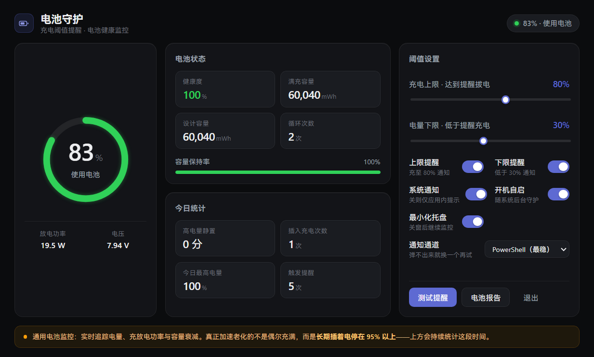

# 电池守护 Battery Guard

> 一个常驻 Windows 托盘的电池监控小工具：实时看电量、功率、电池健康度，
> 充到你设定的电量（比如 80%）时会弹通知提醒你拔掉电源。



---

## 为什么需要它

先说一个反常识的事实：**现代笔记本充满 100% 并不会"过充"**——电池管理芯片会自动断电，
这一点系统比我们做得好。

真正伤电池的是另一件事：**长期插着电源，电量一直停在 95% 以上**。
锂电池在这种高电量状态下放一天，老化的速度明显更快。

所以这个软件的核心不是"防过充"，而是帮你养成两个习惯：

- 🔔 充到 80%（可自己设）→ 弹通知，提醒你拔电源
- ⏱️ 长期插电停在 95% 以上 → 帮你统计每天浪费了多少时间在这上面

> 说明：Windows 没有给普通软件提供"自动断电"的接口，充电的开关只在主板固件手里，
> 所以能做到的就是"到点提醒"。部分联想 / 华硕 / 戴尔机型有厂商私有接口，后续版本计划支持。

---

## 功能

- **电量仪表**：大字显示当前电量，充电 / 放电功率、电压一目了然
- **电池健康**：健康度（满充容量 ÷ 设计容量）、循环次数、容量保持率
- **今日统计**：高电量静置时长、今天插了几次电、最高充到多少
- **阈值提醒**：上限（默认 80%）提醒拔电，下限（默认 30%）提醒充电
- **托盘常驻**：关掉窗口继续监控，托盘图标直接显示电量
- **开机自启**：随系统后台运行，不用手动打开

## 怎么跑起来

需要 Windows 10/11 和 Node.js 18+：

```bash
npm install      # 装依赖
npm run build    # 构建界面
npm start        # 启动
```

嫌麻烦也可以直接**双击 `start.bat`**，它会自动判断要不要先构建。

想自己打个 Windows 安装包？

```bash
pnpm run dist    # 产物在 release/BatteryGuard-Setup-x.x.x.exe
```

---

## 常见问题

**点了测试提醒，系统通知没弹出来？**

先检查 Windows 设置 → 系统 → 通知的总开关，再看看是否开了专注助手。
还不行就在界面右下角「通知通道」下拉换一个试试——默认的 PowerShell 通道最稳。

**充到 80% 会自动断电吗？**

不会。Windows 不允许普通软件控制充电，只能提醒。到阈值时会弹系统通知，拔掉电源就行。

**有些数值显示「—」？**

循环次数来自 Windows 电池报告，首次加载要等几秒；个别机型不提供功率 / 电压数据。

---

## 技术上的一些事

用 Electron + Vue 3 写的。为了能在托盘里安静地待着不费电，电量读取没有走
PowerShell 子进程（单次要 700ms），而是通过 [koffi](https://koffi.dev/) 直接调用
Windows 系统接口，**单次 0.002 毫秒**；窗口隐藏时自动降低刷新频率。
对实现细节感兴趣可以直接看 `electron/` 目录下的代码，都有注释。

## 参与贡献

欢迎 Issue 和 PR。界面的设计规范（配色、排版、组件、响应式）写在 `DESIGN.md` 里。

开发调试可以用内置自检：

```bash
npx electron . --smoke                      # 完整自检：数据、布局、通知、开机自启
npx electron . --screenshot docs/shot.png   # 截一张主界面图
```

## 路线图

- [ ] 联想 / 华硕 / 戴尔等机型的硬件级限充适配
- [ ] 电池健康度历史曲线
- [ ] 自动更新

## 许可证

[MIT](LICENSE)
